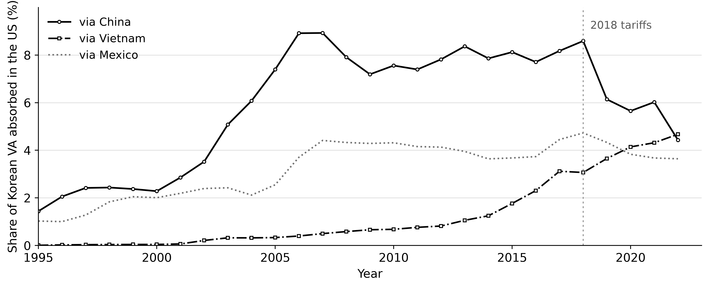

# 중국을 거친 한국 부가가치: 2018년 미중 무역분쟁 전후의 최종 흡수

작성: 2026-09-07, 개정: 2026-11-23

---

## 초록

이 논문은 중국의 생산에 체화된 한국 부가가치가 최종적으로 어디에서 흡수되는지, 그리고 그것이 2018년 미중 무역분쟁 전후로 어떻게 달라졌는지를 분석한다. OECD 국가간산업연관표 확장판(1995\~2022년)을 이용해 한국 부가가치를 최종재 생산국과 최종수요국의 두 축으로 배분한다. 2022년 중국산 최종재에 체화된 한국 부가가치 가운데 76.6%를 중국 내수가, 4.9%를 미국이 흡수했다. 미국이 흡수한 한국 부가가치 중 중국 생산분은 2018년에서 2022년 사이 경상 달러 기준으로 33.0% 줄었으나, 미국이 흡수한 한국 부가가치 전체는 늘었다. 분해 결과에 따르면 이 감소는 중국산 최종재 한 단위에 체화된 한국 함량이 38% 낮아진 데서 나왔고, 중국의 대미 최종재 공급 물량은 오히려 늘었다. 단위당 한국 함량은 중국 내수와 제3국으로 향하는 중국 산출에서도 비슷한 비율로 낮아졌으며, 한국의 감소폭은 79개 공급 경제 가운데 두 번째로 컸다. 미국이 흡수한 한국 부가가치에서 최종재 생산국으로서 베트남의 비중은 중국을 넘어섰다. 중국 생산분의 감소와 베트남 생산분의 증가는 합계에서 거의 상쇄되지만, 이 상쇄는 산업 전반에 고르게 나타나지 않고 전자 산업에 집중되어 있다. 베트남 경유분 가운데 상류에서 중국의 생산을 거친 것은 약 5%에 그친다. 수출 의존도와 실제 관세 인상폭을 노출도 변수로 쓴 회귀에서는 관세 효과가 식별되지 않는다.

JEL 분류: F14, F13, F15, D57, F62

주제어: 부가가치 무역, 미중 무역분쟁, 최종 흡수, 구조분해, 글로벌 가치사슬

## I. 서론

2018년 7월 6일 미국은 약 340억 달러 규모의 중국산 수입품에 25%의 추가 관세를 부과했다(USTR, 2018). 이 조치는 한국 제품을 대상으로 하지 않았지만 간접 피해에 대한 우려를 불러왔다. 중국의 대미 수출이 줄어들면 한국산 중간재에 대한 수요도 줄어들 수 있기 때문이다. 이창수·송백훈(2018)은 아시아개발은행 다지역 산업연관표에 Wang et al. (2013)의 분해를 적용해, 25% 관세 시나리오에서 한국 수출이 103.3억\~132.6억 달러 감소할 것으로 추정했다.

Jones (2026)도 비슷한 설명을 제시한다. 한국의 대중 수출 가운데 약 80%가 중간재이고, 그것으로 만든 중국 제품의 상당 부분이 미국으로 수출된다는 것이다. 그러나 이 설명에는 성격이 다른 두 명제가 결합되어 있다. 하나는 한국이 중국에 무엇을 파는가이고, 다른 하나는 거기에 체화된 부가가치가 최종적으로 어디에서 흡수되는가이다. 목적지에 관한 명제는 구성에 관한 명제에서 도출되지 않는다. 한국산 투입물은 중국 내수나 다른 수출 시장을 위한 중국의 생산에도 쓰일 수 있다. 이 목적지들을 구분해야 하는 이유는 중국 내수에 대한 노출과 중국의 대미 수출을 통한 노출이 같은 것이 아니라는 데 있다.

본 연구는 목적지에 관한 명제를 검토한다. 중국산 최종재에 체화된 한국 부가가치는 어디에서 흡수되며, 그 가운데 미국이 흡수하는 부분은 2018년 이후 어떻게 달라졌는가. 앞에서 인용한 손실 전망은 관세 부과 이전에 작성되었고 중국의 대미 수출이 감소한다는 가정에 근거한다. 그 전망이 전제한 노출이 실제로 축소되었는지, 축소되었다면 어떤 요인을 통해서인지는 2018년 이후의 데이터로 측정된 적이 없다. 2022년까지의 데이터는 2018년 이후 4개 연도의 관측을 제공하므로, 또 하나의 사전 전망이 아니라 사후 평가가 가능하다.

양자 간 총액 무역통계는 직접 거래 상대국을 식별할 뿐 상류 생산을 뒷받침하는 최종수요를 식별하지 않는다. 그래서 본 연구는 OECD 국가간산업연관표 2025년판 확장판(1995\~2022년)을 이용해 한국 부가가치를 최종재 생산국과 최종수요국에 따라 배분한다. 중국과 미국에 관한 주 척도는 중국에서 생산되어 미국에서 흡수된 최종재에 체화된 한국 부가가치이며, 상류에서 중국을 거치는 모든 공급사슬을 포괄하는 것은 아니다. 같은 틀로 중국 내수의 흡수, 그리고 베트남을 포함한 다른 최종재 생산국과의 비교가 가능하다. 이어서 노출도에 근거한 이중차분 분석으로 산업별 조정이 분쟁 이전의 대미 판매 의존도에 따라 달라지는지를 검토한다.

분석 결과는 네 가지다. 첫째, 중국산 최종재에 체화된 한국 부가가치의 약 4분의 3을 중국 내수가 흡수하고, 미국은 약 20분의 1을 흡수한다. 둘째, 미국이 흡수한 부분은 2018년에서 2022년 사이 3분의 1 줄었으나, 그 경로는 기존 전망이 전제한 것과 다르다. 이 기간에 중국의 대미 최종재 공급은 늘었고, 줄어든 것은 그 공급 한 단위에 체화된 한국 함량으로 38% 낮아졌다. 따라서 중국의 대미 판매 감소가 한국산 투입물 수요를 줄인다는 전망의 기제는 데이터에서 확인되지 않는다. 셋째, 단위당 한국 함량은 중국 내수와 제3국 수요를 위한 중국 산출에서도 비슷한 비율로 낮아졌고, 중국의 대미 최종재에 체화된 외국 함량 전체는 거의 달라지지 않았다. 따라서 이 축소는 공급국으로서의 한국에 한정된 것이고 미국이라는 목적지에 한정된 것이 아니다. 이는 미국 관세에서 전달된 수요 충격보다는 중국 생산에 쓰이는 투입물의 조달 변화를 가리키며, 여기에는 한국 기업의 최종 조립 이전이 포함된다. 넷째, 미국이 흡수한 한국 부가가치의 최종재 생산국으로서 베트남의 비중이 중국을 넘어섰으며, 베트남 경유분 가운데 중국의 생산을 상류에서 거친 부분은 작다.

이상은 회계적 결과다. 분쟁 이전의 수출 의존도와 실제 관세 인상폭을 모두 노출도 변수로 쓴 이중차분 분석에서는 관세 효과가 식별되지 않는다. 한국에 대한 추정치는 통계적으로 0과 구분되지 않고, 사전 기간의 계수는 평행추세를 기각한다. 분석은 2022년에서 끝나며 그 이후의 정책 변화를 평가하지 않고, 관측된 조정을 관세만의 결과로 귀속시키지도 않는다. 본 연구의 기여는 중국의 생산과 미국의 한국 부가가치 흡수 사이의 연결이 어느 정도 규모였고 어떻게 변화했는지를 중국 내수의 역할과 함께 확인한 데 있다. 이 측정치는 한국의 생산 연계가 이후 어떻게 달라졌는지를 해석하는 역사적 기준이 된다.

논문의 구성은 다음과 같다. II장은 선행연구를 검토한다. III장은 데이터와 척도를 설명한다. IV장은 목적지별 배분, 분해, 최종재 생산국별·산업별 비교, 강건성 점검을 제시한다. V장은 관세 효과의 식별 가능성을 검토하고 VI장은 결론이다.

## II. 선행연구와 기여

본 연구의 척도는 부가가치 무역 문헌에 속한다. Johnson and Noguera (2012)는 중간재가 국경을 여러 번 넘기 때문에 부가가치 기준의 양자 무역이 총액 기준과 체계적으로 다르다는 것을 보였고, Koopman et al. (2014)는 총수출을 부가가치 항과 이중계상 항으로 분해했다. Wang et al. (2013)은 이 분해를 양자·산업 수준으로 확장했다. 이 연구들은 총액 통계에 기록되는 직접 거래 상대국이 상류 생산을 뒷받침하는 최종수요의 소재지와 다르다는 점을 확립했으며, 본 연구는 이 구분을 중국 생산에 체화된 한국 부가가치에 적용한다. Flaig and Greenville (2021)은 부가가치 분해를 APEC 자유화의 일반균형 분석과 결합해, 통합 지표의 비슷한 변화가 서로 다른 조정을 반영할 수 있음을 보였다.

가장 가까운 선행연구는 이창수·송백훈(2018)이다. 이들은 아시아개발은행 다지역 산업연관표에 Wang et al. (2013)의 분해를 적용해 중국의 대미 수출에 체화된 한국 부가가치를 추정하고, 미국이 중국산 제품에 25% 관세를 부과하는 시나리오를 분석했다. 시나리오에 따른 한국의 수출 손실은 103.3억\~132.6억 달러이고, 산업연관 파급효과를 포함하면 첫째 추정치는 165.8억 달러로 커진다. 전망된 손실의 약 절반은 전자·광학기기에서 발생한다. 이들의 분석은 한국의 간접 노출에 대한 기준을 제공하지만 그 이후의 변화를 측정하지는 않는다. 본 연구는 세 가지 점에서 다르다. 첫째, 가상의 관세 충격을 가정하지 않고 2022년까지 관측된 변화를 분석한다. 둘째, 주 척도는 중간재까지 포함하는 중국의 양자 간 총수출이 아니라 중국산 최종재에 체화되어 미국에서 흡수된 한국 부가가치이며, 두 연구를 비교할 수 있도록 총수출 기준 척도도 함께 제시한다(IV.2절). 셋째, OECD 확장판은 중국의 가공무역 생산과 그 밖의 생산을 구분하므로 관측된 변화가 어느 부문에서 일어났는지를 확인할 수 있다.

두 번째 문헌은 2018년 관세의 효과를 다룬다. Amiti et al. (2019)와 Fajgelbaum et al. (2020)은 관세가 미국의 수입 가격에 거의 전부 전가되었고 대상 품목의 수입을 줄였음을 보였다. 이 연구들은 관세 대상 품목의 미국 내 가격과 수입에 대한 효과를 식별하며, 그 품목의 상류 공급자를 추적하지는 않는다. 무역분쟁 이후의 조정을 다룬 연구는 미국의 조달 변화가 생산의 재배치인지 우회인지를 검토한다. Alfaro and Chor (2023)는 미국 수입에서 중국의 비중이 낮아지고 베트남의 역할이 커진 것을 기록했다. Freund et al. (2024)는 관세 대상 품목에서 미국의 수입이 중국에서 다른 나라로 옮겨갔고, 중국을 대체한 나라들이 중국의 공급망에 이미 통합되어 있던 나라들임을 보였다. Iyoha et al. (2025)는 베트남의 수출 확대에서 우회와 국내 부가가치 창출을 구분했다. 이 연구들의 관심은 제3국 수출에 체화된 부가가치의 구성과 원천이다. 본 연구의 물음은 이를 보완한다. 한국에서 발생한 부가가치가 최종적으로 어디에서 흡수되는가, 그것을 체화한 최종재가 어디에서 생산되는가, 그리고 베트남 경유분이 여전히 중국의 생산에 의존하는가이다.

제3국의 조정이 균일하지 않다는 증거도 있다. Hayakawa and Keola (2025)는 미국의 대중 관세와 태국 기업의 수출 순위 사이에 평균적으로 유의한 관계가 없으나 중국에서 많이 수입하는 기업에서는 수출 증가가 나타남을 보였다. Tung (2026)은 베트남의 조정이 품목 확대에 집중되어 있고 중국산 중간재 의존도가 높은 산업에서 반응이 더 크다고 보고했다. 이 결과들은 산업 수준의 비교가 필요하다는 점을 뒷받침하며, 최종 수출국이 달라졌다고 해서 중국의 상류 생산이 사라진 것으로 볼 수 없다는 점도 보여준다.

세 번째 문헌은 중국 생산의 외국 함량에 관한 것이다. Kee and Tang (2016)은 2000년대에 가공무역 수출 기업이 수입 원자재를 국내산으로 대체하면서 중국 수출의 국내 부가가치 비율이 높아졌음을 보였다. 이러한 전반적 대체가 일어났다면 모든 외국 공급국의 함량이 함께 낮아졌을 것이다. IV.2절은 이 가능성과 한국에 한정된 감소를 구분한다. Shin and Choi (2025)는 아시아 전자 산업 네트워크에서의 국내 부가가치 확보를 다루었는데, 본 연구가 기록한 조정의 대부분이 이 산업에서 일어났다. 한편 중국 생산을 통한 수요가 줄었다고 해서 한국 수출의 순손실이 뒤따르는 것은 아니다. Lovely et al. (2021)은 미국 제조업 수입에서 한국의 비중이 높아진 것을 기록했는데, 이는 본 연구가 다루는 것과 구분되는 무역 전환의 경로다. 이러한 증가는 중국의 수출에 체화된 한국 함량의 감소와 함께 나타날 수 있다. 본 연구는 후자를 중국 내수의 흡수, 다른 최종재 생산국과 함께 사후적으로 분석한다. 본 연구의 기여는 기존 손실 시나리오의 근거가 된 중국 연계 노출을 측정한 데 있으며, 무역분쟁이 한국에 준 득실의 순평가는 대상이 아니다.

## III. 데이터와 분석틀

### 1. 데이터와 범위

OECD 국가간산업연관표(ICIO) 2025년판 확장판은 1995\~2022년, 50개 산업, 80개 경제와 기타 세계를 포괄한다. 중국의 생산은 가공무역 제외 부문(CN1)과 가공무역 부문(CN2)으로 나뉘어 있고, 멕시코도 생산 부문이 나뉘어 있다. 본문의 계정에서는 CN1과 CN2를 합치고, 미국이 흡수한 부분의 부문별 값은 부록 표 A1에 제시한다. 모든 금액은 경상 미국 달러이므로 변화에는 생산과 수요의 변화뿐 아니라 가격과 환율의 변동도 포함된다. 비중과 함량 비율은 단위와 무관하며, 달러 금액 변화가 계산 단위에 따라 얼마나 달라지는지는 IV.5절에서 제시한다.

최종재에는 재화와 서비스가 모두 포함되고, 최종 흡수는 가계 소비보다 넓은 개념이다. 원천 산업은 한국 부가가치가 발생한 산업을 가리키며 해외에서 최종재를 만든 산업을 가리키지 않는다. 그 이전 단계의 생산 유발은 세계 산업연관 계산에 반영되지만 지리적 분류는 최종 생산과 흡수만을 기록한다. 따라서 중국산 중간재에 체화된 뒤 베트남산 최종재에 체화된 한국 부가가치는 중국이 아니라 베트남에 배정된다. IV.3절에서 이 부분을 별도로 측정한다. 이 계정은 한국이 중국에 직접 수출한 중간재 각각의 목적지를 추적하는 것이 아니다.

ICIO는 모든 연도에 대해 관측된 각국 통계표로 작성되는 것이 아니다. 2025년판 보충 노트는 경제·연도별로 각국의 공급사용표나 산업연관표가 있었는지를 보고한다(Yamano et al., 2025, 표 3). 본 연구의 중심이 되는 경제를 보면, 한국의 표는 매년 있고 미국의 표는 2021년까지 있다. 중국의 표는 2012년 이후 2015년, 2017년, 2020년에만 있으므로 2018년, 2019년, 2021년, 2022년은 인접 연도의 표와 국민계정, 무역통계로 추정된 값이다. 베트남의 가장 최근 표는 2016년이다. 따라서 본 연구가 보고하는 2017년 이후 중국의 연도별 변화와 2016년 이후 베트남의 모든 값은 관측된 무역 흐름과 국민계정에 이전 표의 투입 구조를 결합한 결과다. IV.5절에서 중국의 표가 관측된 연도만으로 비교한 결과를 제시한다.

### 2. 부가가치 척도

$A$를 세계 투입계수 행렬, $B = (I - A)^{-1}$를 레온티에프 역행렬, $v$를 부가가치 계수 벡터라 하자. 벡터 $v^{(n)}$은 한국의 원천 산업 $n$의 계수만 남긴 것이다. 국가·산업 $k$의 최종 산출 한 단위에 대한 그 기여는 다음과 같다.

$$U_k^{n} = v^{(n)\prime} B_{\cdot k} \qquad (1)$$

$F_{k,d}$를 국가·산업 $k$가 경제 $d$의 최종수요에 공급한 금액이라 하자. 산업 $n$에서 발생해 경제 $c$가 생산한 최종재에 체화되고 $d$에서 흡수된 한국 부가가치는 다음과 같다.

$$M_{n,c,d} = \sum_{k \in c} U_k^{n} F_{k,d} \qquad (2)$$

제약 $k \in c$는 $c$에 있는 최종재 생산 산업을 선택한다. $u_k = \sum_n U_k^{n}$으로 두면, 중국이 생산하고 미국이 흡수한 부분은 다음과 같다.

$$M_{CHN,USA} = \sum_{n} M_{n,CHN,USA} = \sum_{k \in CHN} u_k F_{k,USA} \qquad (3)$$

표 1은 최종재 생산국을 중국으로 고정하고 최종수요국을 비교하며, 분모는 중국산 최종재 전체에 체화된 한국 부가가치다. 표 4는 최종수요국을 미국으로 고정하고 최종재 생산국을 비교하며, 분모는 미국이 흡수한 한국 부가가치 전체다. 식 (3)의 값은 두 표에 모두 나타나지만 두 비중이 답하는 물음은 다르다. 총수출 기준 연구와 비교하기 위해, 중국의 대미 수출에 체화된 한국 부가가치를 다음과 같이 정의한다.

$$G = \sum_{k \in CHN} u_k \Big( \sum_{j \in USA} Z_{kj} + F_{k,USA} \Big) \qquad (4)$$

식 (4)에서 $Z$는 중간재 판매이고 $u_k$는 한국 함량 계수다. 중간재 항을 제외하면 식 (3)이 된다. $G$는 이창수·송백훈(2018)이 계산한 개념으로, 양자 간 총수출에 체화된 함량이며 최종흡수 기준 척도와 같은 대상이 아니다. 계수에는 중간재와 최종재에 대한 순생산물세가 포함되므로, 배분된 연간 총액은 기초가격 기준 총부가가치가 아니라 세금을 포함한 금액이다. 식 (2)의 배분이 총산출을 전액 배분하고 OECD가 공표하는 부가가치 무역 지표가 재현되는 것이 이 정의에서다. 이 총액은 기초가격 기준 총부가가치보다 약 4% 크며, 기초가격 정의에 따른 결과는 IV.5절에 제시한다. 회계 점검은 부록에 있다.

식 (3)의 변화를 요인별로 분리하기 위해, $V = \sum_{k \in CHN} F_{k,USA}$를 중국의 대미 최종재 공급 총액, $p_g$를 $V$에서 생산 부문 $g$(가공무역 또는 가공무역 제외)가 차지하는 비중, $s_{i|g}$를 부문 $g$ 안에서 산업 $i$가 차지하는 비중이라 하자. 그러면 다음이 성립한다.

$$M_{CHN,USA} = V \sum_{g} p_g \sum_{i} s_{i|g}\, u_{gi} \qquad (5)$$

두 연도 사이 $M_{CHN,USA}$의 변화는 네 가지 효과의 합이다. 최종 산출 한 단위당 한국 함량($u$), 생산 부문 간 구성($p$), 부문 내 산업 구성($s$), 물량($V$)이다. 각 효과는 네 요인을 처음 값에서 나중 값으로 바꾸는 모든 순서에 대한 평균으로 계산하며, 이렇게 하면 효과의 합이 전체 변화와 일치한다. 같은 분해를 중국 내수와 제3국에서 흡수된 중국의 최종 산출에도 적용한다.

산업별 비교는 2018년에 중국 경유분이나 베트남 경유분이 1천만 달러를 넘은 36개 산업을 대상으로 한다. 달러 금액의 변화와, 그 변화를 각 산업의 2018년에 미국이 흡수한 한국 부가가치 전체로 나눈 값을 함께 비교한다. 이중차분 분석은 이 36개 산업 표본이 아니라 V장에서 정의하는 더 넓은 공급 경제×산업 패널을 사용한다. 두 표본을 구분하는 이유는 산업별 비교가 중국과 베트남 두 경로의 대응을 대상으로 하는 데 비해 이중차분 분석은 79개 공급 경제 전체의 산업별 변화를 대상으로 하기 때문이다.

## IV. 최종 목적지와 산업별 조정

### 1. 중국산 최종재에 체화된 한국 부가가치의 흡수

표 1은 식 (2)에서 최종재 생산국 $c$를 중국으로 두고 한국의 모든 산업 $n$에 대해 더한 값을 최종수요국 $d$별로 구한 것이다. 가공무역 부문과 그 밖의 부문을 합쳤으며, 최종수요국은 중국, 미국, 그 밖의 경제로 나누었다. 각 금액 옆의 비중은 그 해 합계에 대한 것이고, 미국 열의 금액이 식 (3)의 값이다. 합계, 구성 항목, 비중은 각각 반올림했으므로 정확히 일치하지 않을 수 있다.

**표 1. 중국산 최종재에 체화된 한국 부가가치의 최종 흡수**

| 연도 | 중국(십억 달러) | 비중(%) | 미국(십억 달러) | 비중(%) | 기타(십억 달러) | 비중(%) | 합계(십억 달러) |
|:---|---:|---:|---:|---:|---:|---:|---:|
| 2017 | 73.95 | 76.0 | 6.40 | 6.6 | 16.99 | 17.5 | 97.33 |
| 2018 | 83.85 | 77.6 | 6.79 | 6.3 | 17.43 | 16.1 | 108.07 |
| 2019 | 71.73 | 78.1 | 4.75 | 5.2 | 15.30 | 16.7 | 91.79 |
| 2020 | 70.08 | 78.7 | 4.35 | 4.9 | 14.60 | 16.4 | 89.02 |
| 2021 | 85.61 | 77.0 | 5.72 | 5.1 | 19.88 | 17.9 | 111.21 |
| 2022 | 71.38 | 76.6 | 4.55 | 4.9 | 17.23 | 18.5 | 93.15 |

자료: OECD (2025) 국가간산업연관표 2025년판 확장판에서 계산.

표에서 보듯이 중국 내수는 표의 모든 연도에서 가장 큰 최종수요지다. 2022년 합계 931.5억 달러 가운데 713.8억 달러(76.6%)를 중국 내수가 흡수했고 미국은 45.5억 달러(4.9%)를 흡수했다. 내수의 비중은 2018년에 이미 77.6%였고 미국은 6.3%였다. 따라서 내수의 우위는 이후 미국이 흡수한 금액이 줄어든 결과만은 아니다.

2018년에서 2022년 사이 중국 생산분 합계는 1,080.7억 달러에서 931.5억 달러로 줄었다. 내수가 흡수한 금액은 838.5억 달러에서 713.8억 달러로, 미국이 흡수한 금액은 67.9억 달러에서 45.5억 달러로 줄었다. 비율로는 미국이 흡수한 금액이 더 크게 줄었지만, 규모가 훨씬 큰 내수분이 여전히 합계의 중심이다. 이 목적지 결과는 한국의 대중 수출 구성과 구분된다. 대중 수출에서 중간재의 비중은 2022년 78.5%였다. 중간재 수출 비중이 높다는 사실은 최종 목적지가 주로 미국이라는 것을 뒷받침하지 않는다.

### 2. 중국의 대미 판매에 체화된 한국 부가가치: 규모와 변화의 요인

표 2는 중국의 대미 총수출과 대미 최종재 공급, 그리고 각각에 체화된 한국 부가가치를 함께 제시한다. 둘째 열이 식 (4)의 $G$이고 다섯째 열이 식 (3)의 $M_{CHN,USA}$다. 비중은 $G$를 대미 총수출로 나눈 것이고, 마지막 열은 $M_{CHN,USA}$를 대미 최종재 공급 $V$로 나눈 단위당 함량이다.

**표 2. 중국의 대미 판매에 체화된 한국 부가가치**

| 연도 | 중국의 대미 총수출(십억 달러) | 한국 부가가치, 총수출 기준 $G$(십억 달러) | 비중(%) | 중국의 대미 최종재 공급 $V$(십억 달러) | 한국 부가가치, 최종흡수 기준 $M$(십억 달러) | 단위당 함량 $M/V$(%) |
|:---|---:|---:|---:|---:|---:|---:|
| 2004 | 150.5 | 4.27 | 2.84 | 101.1 | 2.92 | 2.89 |
| 2010 | 278.9 | 5.23 | 1.87 | 187.7 | 3.68 | 1.96 |
| 2015 | 427.6 | 8.20 | 1.92 | 297.0 | 6.14 | 2.07 |
| 2017 | 427.7 | 8.90 | 2.08 | 292.5 | 6.40 | 2.19 |
| 2018 | 473.6 | 9.72 | 2.05 | 313.3 | 6.79 | 2.17 |
| 2019 | 418.2 | 7.06 | 1.69 | 271.7 | 4.75 | 1.75 |
| 2020 | 418.9 | 6.45 | 1.54 | 270.8 | 4.35 | 1.60 |
| 2021 | 519.9 | 8.53 | 1.64 | 333.0 | 5.72 | 1.72 |
| 2022 | 532.2 | 6.78 | 1.27 | 338.7 | 4.55 | 1.34 |

자료: OECD (2025) 국가간산업연관표 2025년판 확장판에서 계산.

표에서 보듯이 중국의 대미 총수출에서 한국 부가가치의 비중은 2004년 2.84%가 정점이었고 28개 연도 가운데 3%를 넘은 해가 없다. 2010년대에는 1.8\~2.1% 사이에 있다가 2019년 1.69%로 낮아졌고 2022년에는 1.27%다. 금액으로는 2018년이 정점이며 총수출 기준 97.2억 달러, 최종흡수 기준 67.9억 달러다. 두 척도는 함께 움직이며, 표의 모든 연도에서 최종흡수 기준이 총수출 기준의 67\~75%다.

이 수치는 이창수·송백훈(2018)의 전망과 비교할 수 있다. 이들의 기준값은 중국의 대미 재화 수출에서 한국 부가가치의 비중을 2.87%로 계산했고, 본 연구의 계산을 재화로 한정하면 2016년과 2017년 모두 2.32%다. 두 데이터베이스는 관세 이전의 비중이 2\~3%였다는 점에서 일치한다. 이들이 전망한 103.3억\~132.6억 달러의 손실은 모든 품목에 25% 관세가 부과될 때 중국의 대미 수출이 감소한다는 가정에 이 비중을 적용한 것이다. 실현된 $G$의 변화는 2018년에서 2022년 사이 29.4억 달러 감소, 2017년 대비로는 21.2억 달러 감소다. 격차의 원인은 세 가지다. 첫째, 전망은 관세가 없는 가상 상황으로부터의 이탈이고 실현치는 경상 달러 기준의 시간에 따른 변화다. 둘째, 시나리오는 모든 중국산 제품에 25%를 부과하지만 실제 관세는 단계적으로 부과되었고 주요 전자 제품은 과세되지 않았다(V장). 셋째이자 가장 중요한 원인은 전망이 전제한 기제가 작동하지 않았다는 것이다. 2022년 중국의 대미 총수출은 2018년보다 12% 많았다. $G$의 변화를 비중 효과와 물량 효과로 나누면 각각 -39.2억 달러와 +9.7억 달러다. 감소 전체가, 그리고 그 이상이 한국 비중의 하락에서 나왔다.

표 3은 식 (5)의 분해를 최종흡수 기준 척도에 적용한 결과다. 첫째와 둘째 열은 미국이 흡수한 부분을 2018년 기준과 2017년 기준으로 분해한 것이고, 셋째와 넷째 열은 같은 분해를 중국 내수와 그 밖의 경제가 흡수한 부분에 적용한 것이다. 변화 아래의 네 행이 식 (5)의 네 효과이며, 마지막 두 행은 단위당 한국 함량의 처음 값과 나중 값이다. 가공무역 부문의 산출은 중국 내수에 판매되지 않으므로 중국 열에는 부문 구성 효과가 없다.

**표 3. 중국산 최종재에 체화된 한국 부가가치 변화의 분해**

| | 미국, 2018\~2022 | 미국, 2017\~2022 | 중국, 2018\~2022 | 기타, 2018\~2022 |
|:---|---:|---:|---:|---:|
| 처음 값(십억 달러) | 6.79 | 6.40 | 83.85 | 17.43 |
| 나중 값(십억 달러) | 4.55 | 4.55 | 71.38 | 17.23 |
| 변화(십억 달러) | -2.24 | -1.85 | -12.47 | -0.20 |
| 단위당 한국 함량 효과 | -1.96 | -2.08 | -31.43 | -6.43 |
| 가공무역 부문 구성 효과 | -0.43 | -0.40 | | -0.48 |
| 산업 구성 효과 | -0.29 | -0.18 | -0.26 | +0.33 |
| 최종재 공급 물량 효과 | +0.44 | +0.81 | +19.22 | +6.37 |
| 단위당 함량, 처음(%) | 2.17 | 2.19 | 0.67 | 1.93 |
| 단위당 함량, 나중(%) | 1.34 | 1.34 | 0.45 | 1.33 |

주: 열은 최종수요 경제다. 효과는 식 (5)의 네 요인을 바꾸는 모든 순서의 평균이며, 반올림 범위 안에서 그 합이 변화와 같다.\
자료: OECD (2025) 국가간산업연관표 2025년판 확장판에서 계산.

표에서 보듯이 2018년에서 2022년 사이 미국이 흡수한 금액의 감소 22.4억 달러 가운데 19.6억 달러가 단위당 한국 함량의 하락에서 나왔다. 수입 투입물을 덜 쓰는 가공무역 제외 부문으로의 이동이 4.3억 달러, 산업 구성이 2.9억 달러를 더 설명한다. 물량은 4.4억 달러만큼 증가 방향으로 기여했다. 2017년을 기준으로 해도 함량 효과는 20.8억 달러로 거의 같고, 물량 효과는 2017년 수준에서 공급이 더 많이 늘어났으므로 더 크다. 중국의 대미 최종재 한 단위에 체화된 한국 함량은 2.17%에서 1.34%로 38% 낮아졌다. 표의 나머지 열은 함량의 하락이 미국으로 향하는 산출에 한정되지 않는다는 것을 보여준다. 중국 최종 산출 한 단위당 한국 함량은 내수가 흡수한 산출에서 33%, 제3국이 흡수한 산출에서 31% 낮아졌다. 두 경우 모두 함량 효과가 크게 음수이고, 중국 최종 산출의 물량 증가가 이를 일부 또는 거의 전부 상쇄했다. 따라서 미국이 흡수한 금액의 감소는 중국 생산에서 한국 함량이 전반적으로 낮아진 현상의 한 사례이며, 미국으로 향하는 산출에서 그 폭이 다소 더 크다.

이 전반적 하락은 공급국으로서의 한국에 한정된 것이다. 중국의 대미 최종재에 체화된 외국 함량 전체는 2018년 17.3%에서 2022년 16.1%로 거의 달라지지 않았으나, 그 외국 함량에서 한국이 차지하는 비중은 12.6%에서 8.4%로 낮아졌다. Kee and Tang (2016)이 2000년대에 대해 기록한 것과 같은 수입 투입물의 전반적 국내 대체가 원인이라면 모든 공급국의 함량이 함께 낮아졌을 것이므로, 그것으로는 이 양상이 설명되지 않는다. 이 양상은 중국 생산자가 이용하는 외국 공급국이 달라졌거나, 한국산 투입물을 집약적으로 쓰던 최종 생산이 중국 밖으로 이전한 경우와 부합한다. 산업연관 계정으로는 두 가지를 구분할 수 없다.

공급 경제 간 비교도 이 해석과 부합한다. 식 (3)을 79개 공급 경제 각각에 대해 계산하면, 미국이 흡수한 중국 생산분의 2018\~2022년 변화율 중위값은 +5.4%인 데 비해 한국은 -33.0%이고, 한국보다 더 크게 감소한 경제는 하나다. 2017년을 기준으로 하면 중위값은 +20.2%, 한국은 -28.9%다. 다른 공급 경제는 비교를 위한 관측이며, 한국에 한정된 관세에 대해 처치를 받지 않은 통제집단이 아니다. 이 비교는 표로 제시하지 않고 수치만 적는다.

### 3. 최종재 생산국별 미국 흡수

표 4는 식 (2)에서 최종수요국 $d$를 미국으로 두고 한국의 모든 산업에 대해 더한 값을 최종재 생산국 $c$별로 구한 것이다. 미국의 최종수요가 흡수한 한국 부가가치 전체가 대상이며, 중국 열이 식 (3)의 값이다. 각 금액 옆의 비중은 그 해 합계에 대한 것이다. 열은 최종재 생산국을 나타내며 그 이전의 중간재 생산 단계 전체를 나타내지 않는다.

**표 4. 미국이 흡수한 한국 부가가치의 최종재 생산국별 구성**

| 연도 | 한국(십억 달러) | 비중(%) | 미국(십억 달러) | 비중(%) | 중국(십억 달러) | 비중(%) | 베트남(십억 달러) | 비중(%) | 멕시코(십억 달러) | 비중(%) | 기타(십억 달러) | 비중(%) | 합계(십억 달러) |
|:---|---:|---:|---:|---:|---:|---:|---:|---:|---:|---:|---:|---:|---:|
| 2017 | 36.1 | 46.2 | 24.6 | 31.5 | 6.4 | 8.2 | 2.4 | 3.1 | 3.5 | 4.5 | 5.2 | 6.6 | 78.3 |
| 2018 | 35.5 | 44.9 | 25.0 | 31.7 | 6.8 | 8.6 | 2.4 | 3.1 | 3.7 | 4.7 | 5.5 | 7.0 | 79.0 |
| 2019 | 35.9 | 46.3 | 25.7 | 33.1 | 4.8 | 6.1 | 2.8 | 3.7 | 3.4 | 4.3 | 5.0 | 6.4 | 77.4 |
| 2020 | 36.5 | 47.4 | 25.2 | 32.8 | 4.3 | 5.7 | 3.2 | 4.1 | 2.9 | 3.8 | 4.8 | 6.2 | 76.9 |
| 2021 | 42.5 | 44.8 | 33.2 | 34.9 | 5.7 | 6.0 | 4.1 | 4.3 | 3.5 | 3.7 | 6.0 | 6.3 | 95.0 |
| 2022 | 46.2 | 45.0 | 36.7 | 35.8 | 4.5 | 4.4 | 4.8 | 4.7 | 3.7 | 3.6 | 6.6 | 6.5 | 102.6 |

자료: OECD (2025) 국가간산업연관표 2025년판 확장판에서 계산.

표에서 보듯이 한국과 미국에서 생산된 최종재가 가장 큰 비중을 차지하고, 중국과 베트남은 그보다 작은 제3국 경로다. 중국의 비중은 2018년 8.6%에서 2022년 4.4%로 낮아졌고 베트남의 비중은 3.1%에서 4.7%로 높아졌다. 미국이 흡수한 총액은 790억 달러에서 1,026억 달러로 늘어났다. 따라서 중국 생산분의 감소는 미국 수요에 대한 한국의 부가가치 노출 전체가 줄어든 것이 아니다. 그림 1은 세 제3국 경로의 비중을 전 기간에 대해 보여준다. 표로는 두 계열이 교차하는 시점과 2019년 하락의 상대적 크기가 드러나지 않으므로 그림으로 제시한다. 분모는 미국이 흡수한 한국 부가가치 전체이고, 그림의 「via」는 최종재 생산국을 뜻한다. 2018년 표시는 시점을 나타낼 뿐 추정된 인과적 단절이 아니다.

**그림 1. 미국이 흡수한 한국 부가가치에서 제3국 최종재 생산이 차지하는 비중, 1995\~2022년**

자료: OECD (2025) 국가간산업연관표 2025년판 확장판에서 계산.

그림에서 베트남의 비중은 2018년 이전부터 높아지고 있었다. 중국의 비중은 그 이전 기간의 대부분에 7\~9% 수준이었고, 2019년의 2.5%p 하락은 그 이전의 연간 변동 최댓값 1.6%p보다 크다. 중국 경유 금액은 2021년에 57.2억 달러로 일시 회복했으나 2018년 수준에 미치지 못했고 2022년에 다시 줄었다. 이 관찰은 시점과 구성을 확인해 줄 뿐이며 관세, 조달 변화, 기업 이전 각각의 기여를 분리해 주지 않는다.

베트남의 최종 생산에도 중국산 투입물이 쓰일 수 있다. 태국 기업과 베트남 품목에 대한 연구도 제3국의 수출 증가를 중국산 투입물 의존과 연결한다(Hayakawa & Keola, 2025; Tung, 2026). 부가가치가 최종재 생산국에 배정되므로, 한국 부가가치가 상류에서 중국의 생산에 의존하는 정도가 전혀 달라지지 않아도 중국 경유분은 줄고 베트남 경유분은 늘어날 수 있다. 이를 측정하기 위해 생산 단계와 무관하게 중국의 생산을 한 번이라도 거쳐 미국 최종수요에 도달한 한국 부가가치를 계산한다. $\tilde{u}_k$를 세계 체계에서 중국의 생산을 제외하고 계산한 최종 산출 $k$의 한국 함량이라 하면, $\tilde{u}_k$는 중국을 전혀 거치지 않는 공급사슬만 계상한다. 중국 밖의 최종재 생산자에 대해 $(u_k - \tilde{u}_k) F_{k,USA}$는 그 생산자에 도달하기 전에 중국의 생산을 거친 한국 부가가치다. 표 5는 그 결과를 최종재 생산국별로 제시한다. 중국 행은 식 (3)의 값이고, 나머지 행은 중국산 중간재에 체화되어 해당 경제의 최종 생산에 투입된 한국 부가가치다.

**표 5. 중국의 생산을 한 번이라도 거쳐 미국에서 흡수된 한국 부가가치**

| 최종재 생산국 | 2017 | 2018 | 2019 | 2022 |
|:---|---:|---:|---:|---:|
| 중국(십억 달러) | 6.40 | 6.79 | 4.75 | 4.55 |
| 베트남(십억 달러) | 0.09 | 0.10 | 0.13 | 0.25 |
| 멕시코(십억 달러) | 0.47 | 0.56 | 0.45 | 0.49 |
| 미국(십억 달러) | 2.56 | 2.96 | 2.45 | 2.58 |
| 한국과 기타(십억 달러) | 0.60 | 0.62 | 0.54 | 0.68 |
| 중국 생산 경유 합계(십억 달러) | 10.12 | 11.03 | 8.32 | 8.53 |
| 미국이 흡수한 전체 대비 비중(%) | 12.9 | 14.0 | 10.7 | 8.3 |
| 베트남 경유분 가운데 중국 생산 경유 비중(%) | 3.8 | 4.0 | 4.6 | 5.2 |

자료: OECD (2025) 국가간산업연관표 2025년판 확장판에서 계산.

표에서 두 가지를 확인할 수 있다. 첫째, 넓은 척도로도 감소가 나타난다. 생산 단계와 무관하게 중국의 생산을 거쳐 미국 최종수요에 도달한 한국 부가가치는 2018년 110.3억 달러에서 2022년 85.3억 달러로 22.6% 줄었고, 미국이 흡수한 전체에서 차지하는 비중은 14.0%에서 8.3%로 낮아졌다. 중국산 중간재에 체화되어 다른 나라, 주로 미국 자신의 최종 생산에 쓰인 부분은 42.4억 달러와 39.9억 달러로 거의 같다. 둘째, 베트남 경유분은 중국의 생산에 거의 의존하지 않는다. 2018년에서 2022년 사이 베트남 경유분의 증가 23.7억 달러 가운데 중국의 생산을 거친 것은 1.5억 달러다. 베트남산 대미 최종재에 체화된 한국 부가가치는 대부분 중국을 포함하지 않는 공급사슬로 공급된다. III.1절에서 밝힌 데이터의 한계를 전제로, 중국에서 베트남으로의 이동은 중국 상류 생산에 대한 의존이 그대로인 채 최종재 생산국만 달라진 것이 아니다.

### 4. 중국·베트남 상쇄의 산업 집중

표 6은 2018\~2022년의 변화를 한국의 원천 산업별로 비교한다. 대상은 III.2절에서 정한 36개 산업이다. 패널 A는 2018년 중국 경유분이 가장 큰 5개 산업의 변화와 36개 산업 합계의 근삿값을 제시하고, 패널 B는 두 변화의 산업 간 상관계수와 회귀 기울기를 제시한다. 규모 조정은 두 변화를 그 산업의 2018년에 미국이 흡수한 한국 부가가치 전체로 나눈 것이다. 상관계수의 괄호는 상관이 0이라는 가설에 대한 양측 $p$값이고 기울기의 괄호는 표준오차다.

**표 6. 산업 집중과 규모 조정 비교, 2018\~2022년**

패널 A. 한국 원천 산업별 변화 (백만 달러)

| 한국 원천 산업 | 중국 경유 변화 | 베트남 경유 변화 |
|:---|---:|---:|
| 컴퓨터, 전자, 광학기기 | -1,056 | +1,181 |
| 도소매, 자동차 수리 | -302 | +317 |
| 화학 | -151 | +97 |
| 전문, 과학, 기술 서비스 | -108 | +44 |
| 사업지원 서비스 | -53 | +43 |
| 36개 산업 합계(근삿값) | -2,220 | +2,360 |

패널 B. 산업 간 비교

| 통계량 | 36개 산업 전체 | 전자 제외(35개) |
|:---|---:|---:|
| 상관계수, 금액 변화 | -0.987 ($p < 0.001$) | -0.858 ($p < 0.001$) |
| 회귀 기울기, 금액 변화 | -1.094 (0.030) | -0.824 (0.086) |
| 상관계수, 규모 조정 변화 | +0.305 ($p = 0.070$) | +0.531 ($p = 0.001$) |

자료: OECD (2025) 국가간산업연관표 2025년판 확장판에서 계산.

표에서 보듯이 36개 산업에서 중국 경유분은 약 22.2억 달러 줄고 베트남 경유분은 23.6억 달러 늘었다. 전자 산업이 감소분의 10.56억 달러(약 48%)와 증가분의 11.81억 달러(약 50%)를 차지한다. 도소매 항목은 최종 생산에 체화된 한국의 유통 서비스 부가가치이며, 반드시 최종재로 수출된 서비스인 것은 아니다. 금액 변화의 상관계수는 -0.987이고 전자를 제외해도 -0.858이다. 회귀 기울기는 각각 -1.094와 -0.824다. 그러나 원천 산업의 대미 노출 규모로 정규화하면 상관계수는 +0.305가 되고 전자를 제외하면 +0.531이며, 앞의 값은 5% 수준에서 유의하지 않다. 따라서 중국 경유분의 비례적 감소가 큰 산업에서 베트남 경유분의 비례적 증가가 체계적으로 더 크게 나타나지는 않는다. 금액 기준의 음의 상관은 달러 금액의 상쇄가 거의 일치한다는 것을 기록할 뿐이며 균일한 대체를 입증하지 않는다. 전자 산업은 집계 변화의 중심에 있고 이는 Shin and Choi (2025)가 국내 부가가치 확보에 주목한 것과 부합하지만, 두 경로의 변화가 대응한다고 해서 개별 기업의 이전이 식별되는 것은 아니다.

### 5. 강건성

단위와 기준연도부터 살펴본다. 미국이 흡수한 중국 생산분의 달러 기준 감소율은 기준연도와 계산 단위에 따라 달라진다. 2018년에서 2022년 사이 감소율은 경상 달러로 33.0%, 미국의 중국산 수입물가지수로 실질화하면 35.7%, 한국 GDP 디플레이터로 실질화한 원화로는 25.8%이며, 마지막 차이는 2022년 원화 약세를 반영한다. 2017년을 기준으로 하면 경상 달러 감소율은 28.9%, 2015\~2017년 평균을 기준으로 하면 25.6%다. 반면 단위와 무관한 지표인 중국의 대미 최종재 단위당 한국 함량은 2018년 대비 38.0%, 2017년 대비 38.6%, 2015\~2017년 평균 대비 37.2% 낮아졌다. 따라서 안정적인 결과는 함량의 하락이며, 4분의 1에서 3분의 1에 이르는 달러 기준 감소는 물량 증가를 함께 고려할 때 거기서 도출된다.

다음은 통계표가 관측된 연도만으로 한 비교다. 중국의 통계표가 모두 있는 2017년과 2020년으로 비교를 한정하면 미국이 흡수한 중국 생산분은 32.1% 감소하고 단위당 한국 함량은 26.6% 낮아진다. 79개 공급 경제의 변화율 중위값은 -7.0%이고 한국보다 더 크게 감소한 경제는 4개다. 따라서 감소는 관측된 표 사이에서도 확인된다. 베트남 경유분은 이런 방식으로 확인할 수 없다. 2016년 이후의 베트남 통계표가 없기 때문이며, 베트남 경유분의 증가는 이 한계를 염두에 두고 해석해야 한다.

마지막으로 부가가치의 정의와 산업연관표의 판을 살펴본다. 부가가치 계수에서 순생산물세를 제외하면 미국이 흡수한 중국 생산분은 매년 약 4% 작아진다. 2018\~2022년 감소율은 33.0%에서 33.4%로, 2022년 중국 내수가 흡수한 비중은 76.6%에서 76.5%로 달라진다. 가공무역 생산을 구분하지 않는 ICIO 표준판에서는 수준이 6\~8% 낮고 감소율은 32.2%다(부록 표 A1).

## V. 관세 효과를 식별할 수 있는가

IV장의 계정은 축소의 규모와 시점, 요인을 확인해 주지만 원인을 확인해 주지는 않는다. 이 장은 노출도가 높은 산업과 낮은 산업을 비교해 그 축소를 미국의 관세에 귀속시킬 수 있는지를 검토한다. 귀속시킬 수 없다. 이 분석을 보고하는 이유는 IV장의 측정치를 관세 효과로 해석해서는 안 된다는 점, 그리고 이 물음에 답할 수 있는 설계가 무엇을 필요로 하는지를 보이기 위해서다.

### 1. 사양과 표본

$s$, $i$, $t$를 각각 공급 경제, 원천 산업, 연도라 하자. 결과 변수 $M_{sit}$는 식 (2)를 각 공급 경제의 원천 산업별 부가가치로 일반화한 것으로, 중국산 최종재에 체화되어 미국에서 흡수된 금액(백만 달러)이다. 노출도는 2017년 중국 산업 $i$의 대미 총수출을 그 산업의 산출로 나눈 값이다. 0과 1 사이의 값이며 무역분쟁 이전에 고정되어 있다. 각 원천 산업에는 같은 분류의 중국 산업의 노출도를 대응시킨다.

이 변수는 기준 시점의 수출 의존도를 측정하며 실제 관세 변화를 측정하지 않는다. 그래서 둘째 노출도 변수로 실제 관세 인상폭을 함께 쓴다. 2017년 12월에서 2020년 3월 사이 미국의 대중 수입에 대한 교역액 가중 평균 관세율의 산업별 변화이며, Waugh (n.d.)의 정리본을 이용했고 NAICS 3자리 산업을 ICIO 산업에 대응시켰으며 서비스 산업은 0으로 두었다. 같은 산업끼리 대응시키는 방식은 산업 간 투입 연계를 반영하지 못한다. 한국 화학 산업의 부가가치는 중국 화학 산업이 아니라 중국 전자 산업에 투입될 수 있다. 노출도를 최종재를 생산하는 중국 산업에 따라 대응시켜도 아래의 결론은 달라지지 않는다. 지시변수 $post_t$는 2019년부터 1이고 그 이전은 0이다. 관세는 2018년 중에 시작되었으나(USTR, 2018) 이 사양은 2018년을 0에 포함하므로, 2018년은 처치를 전혀 받지 않은 비교 연도가 아니다. 기본 추정식은 다음과 같다.

$$\log(1 + M_{sit}) = \alpha_{si} + \delta_{st} + \beta\,(post_t \times exposure_i) + \varepsilon_{sit} \qquad (6)$$

공급 경제×산업 고정효과 $\alpha_{si}$는 시간에 따라 변하지 않는 차이를 통제하고, 공급 경제×연도 고정효과 $\delta_{st}$는 각 공급 경제 안에서 산업에 공통된 연도별 변동을 통제한다. 계수 $\beta$는 같은 공급 경제 안에서 기준 시점의 노출도가 다른 산업의 사후 기간 변화를 비교한다. 둘째 사양은 $post_t \times exposure_i \times 1\{s = KOR\}$을 추가하며 그 계수가 $\gamma$다. 이때 $\beta$는 다른 공급 경제의 공통 기울기이고 $\gamma$는 한국의 추가 기울기이며 한국의 전체 반응이 아니다. 한국 자체의 기울기는 $\beta + \gamma$다.

불균형 패널은 2010\~2022년, 79개 공급 경제, 49개 산업의 양수 관측 49,733개다. 표준오차는 산업 수준에서 군집한다. 관측의 56.5%가 1백만 달러 미만이므로 $\log(1 + M)$ 변환은 큰 관측뿐 아니라 작은 관측에도 영향을 준다. 1을 더하는 것은 단위에 의존하는 척도의 선택이지 0인 관측을 처리하는 방법이 아니며, 계수는 탄력성이 아니다. 이상이 보고하는 사양이며, 다른 결과 변수 변환이나 표본 선택을 고려한 추정은 보고하지 않는다.

### 2. 이중차분 추정 결과

표 7은 기본 사양과 한국 교차항을 추가한 사양의 추정 결과다. 첫째와 둘째 열은 수출 의존도를, 셋째와 넷째 열은 관세 인상폭을 노출도 변수로 쓴 것이며, 각 변수에 대해 기본 사양과 한국 교차항을 추가한 사양을 제시한다. 셋째 행이 한국 자체의 기울기 $\beta + \gamma$다. 관세 인상폭은 비율로 측정했다(25%p 인상이 0.25). 괄호는 산업 수준에서 군집한 표준오차이고 대괄호는 추정에서 얻은 양측 $p$값이다.

**표 7. 노출도를 이용한 이중차분 추정 결과**

| | 수출 의존도, 기본 | 수출 의존도, 한국 교차 | 관세 인상폭, 기본 | 관세 인상폭, 한국 교차 |
|:---|---:|---:|---:|---:|
| $post \times exposure$ ($\beta$) | +0.396 (0.248) [0.117] | +0.423 (0.242) [0.086] | -0.026 (0.073) [0.720] | -0.019 (0.072) [0.789] |
| $post \times exposure \times$ 한국 ($\gamma$) | | -2.135 (1.106) [0.059] | | -0.535 (0.415) [0.204] |
| 한국의 기울기 ($\beta + \gamma$) | | -1.712 (1.230) [0.170] | | -0.554 (0.427) [0.201] |
| 공급 경제×산업 고정효과 | 포함 | 포함 | 포함 | 포함 |
| 공급 경제×연도 고정효과 | 포함 | 포함 | 포함 | 포함 |
| 관측 수 | 49,733 | 49,733 | 49,733 | 49,733 |
| 공급 경제 수 | 79 | 79 | 79 | 79 |
| 산업 군집 수 | 49 | 49 | 49 | 49 |

주: 표본 기간은 2010\~2022년이다. $p$값은 자유도 48의 $t$ 분포에 따른다.\
자료: OECD (2025) 국가간산업연관표 2025년판 확장판과 Waugh (n.d.)에서 계산.

표에서 보듯이 수출 의존도를 노출도 변수로 쓰면 기본 사양의 계수는 +0.396, 표준오차 0.248이다. 둘째 사양에서 공통 계수는 +0.423(0.242)이고 한국의 추가 기울기는 -2.135(1.106)다. 따라서 추정 결과에는 공급 경제 전반에 공통된 음의 사후 기울기가 나타나지 않는다. 관심 대상인 한국 자체의 기울기는 -1.712, 표준오차 1.230, $p$값 0.170이다. 관세 인상폭을 노출도 변수로 쓰면 한국의 기울기는 -0.554이고 $p$값은 0.201이다. 이 변수의 변동은 대부분 과세된 재화 산업과 과세되지 않은 서비스 산업 사이에 있으며, 표본을 재화 산업으로 한정하면 한국의 기울기는 -0.119, 표준오차 0.797이다. 결과 변수에 맞추어 수출 의존도를 최종재 공급만으로 측정하면 -1.862, 표준오차 1.504다. 어느 사양에서도 한국의 기울기는 통상적 수준에서 0과 구분되지 않는다.

인과적 해석에는 노출도가 높은 한국 산업과 낮은 한국 산업이 2018년 이전에 평행한 추세를 따랐다는 조건도 필요하다. 부록 표 A2는 사후 기간 교차항을 2017년 기준의 연도별 교차항으로 대체한 한국 전용 사건연구 결과다. 사전 기간의 계수는 두 노출도 변수 모두에서 결합적으로 0과 다르고(수출 의존도 $p < 0.001$, 관세 인상폭 $p = 0.003$), 절댓값이 사후 기간의 계수보다 크다. 사전 기간 계수의 변동이 사후 기간 계수보다 큰 경우 사후 기간의 움직임을 처치에 귀속시킬 수 없다(Roth, 2022).

### 3. 식별되지 않는 이유

산업 수준의 연간 데이터로 식별할 수 있는 범위를 제한하는 요인은 두 가지다. 첫째는 관세의 구조다. 2019년 9월까지 대중 수입 HS 6단위 세번의 96.9%에서 관세가 인상되었으므로, 산업이 과세되었는지 여부에는 변동이 거의 남지 않는다. 인상폭에는 변동이 있으나 그 방향은 한국에 대한 관세 설명에 유리하지 않다. 교역액 가중 인상폭은 기계, 전기장비, 자동차에서 21\~25%p인 데 비해 컴퓨터, 전자, 광학기기에서는 13.7%p다. 가장 큰 품목에 속하는 휴대전화와 휴대용 컴퓨터가 과세되지 않았기 때문이다. 한국의 감소 가운데 절반이 일어난 산업은 제조업 가운데 관세가 상대적으로 덜 부과된 산업이다. 이 사실은 그 산업의 감소를 관세로 설명하는 데 유리하지 않다. 다만 산업 안의 과세 품목에 대한 관세 효과까지 계정으로 배제할 수는 없다.

둘째는 한국이 단일 공급 경제이고, 2018년 이전에도 중국 연계 금액의 변동이 컸던 49개 산업에 걸쳐 비교된다는 점이다. 일본의 2019년 수출규제, 반도체 경기, 한국 전자 산업의 생산 이전과 같은 한국 고유의 사건이 사후 기간에 포함되어 있고, 다른 공급 경제도 관세와 무역 전환에 노출되어 있었다. 관세 효과를 분리하려면 품목 수준의 관세 변화를 처치로 삼고 월 단위 무역 데이터와 기업 수준의 생산 입지 정보를 결합해야 한다. 이는 국가간산업연관표로 답할 수 있는 범위 밖이다.

## VI. 결론

본 연구는 중국의 생산에 체화된 한국 부가가치가 최종적으로 어디에서 흡수되는지, 그리고 그것이 2018년 미중 무역분쟁 전후로 어떻게 달라졌는지를 분석했다. OECD 국가간산업연관표(1995\~2022년)를 이용해 한국의 대중 수출 구성과 중국의 생산에 체화된 부가가치의 최종 목적지를 구분했다. 회계 분석에 더해 산업 수준의 비교와 노출도에 근거한 이중차분 분석을 수행했다.

주요 결과는 네 가지다. 첫째, 한국은 중간재 수출을 통해 중국의 생산에 깊이 통합되어 있지만, 중국산 최종재에 체화된 한국 부가가치의 대부분은 미국이 아니라 중국 내수가 흡수한다. 둘째, 미국이 흡수한 한국 부가가치 중 중국 생산분은 2018년 이후 크게 줄었으나 감소의 요인은 기존 전망이 전제한 것과 다르다. 중국의 대미 최종재 공급은 늘었고, 그 공급 한 단위당 한국 함량이 38% 낮아졌다. 단위당 함량은 중국 내수와 제3국 수요를 위한 산출에서도 약 3분의 1 낮아졌고 중국의 대미 공급에 체화된 외국 함량 전체는 거의 달라지지 않았으므로, 이 축소는 공급국으로서의 한국에 한정되고 목적지 전반에 걸쳐 있다. 셋째, 미국이 흡수한 한국 부가가치에서 최종재 생산국으로서 베트남이 더 중요해졌다. 중국 생산분의 감소와 베트남 생산분의 증가는 합계에서 거의 상쇄되지만, 이 상쇄는 산업 전반에 고르게 나타나지 않고 전자 산업에 집중되어 있으며, 베트남 경유분 가운데 상류에서 중국의 생산을 거친 것은 약 5%에 그친다. 넷째, 계량 분석에서는 관세 효과가 식별되지 않는다. 한국의 노출도 기울기는 기준 시점의 수출 의존도와 실제 관세 인상폭 어느 쪽을 써도 통계적으로 0과 구분되지 않고, 사전 기간의 계수는 평행추세를 기각한다. 관세, 중국 생산자의 조달 변화, 한국 기업의 생산 이전이 모두 설명의 후보로 남는다. 다만 감소가 미국으로 향하는 산출에 한정되지 않고 관세가 덜 부과된 산업에 집중되어 있다는 결과는 관세만으로 설명하기 어렵다는 것을 시사한다.

따라서 본 연구의 주된 기여는 선행연구가 전망한 경로를 사후적으로 측정한 데 있다. 선행연구는 중국을 통한 한국의 간접 손실 가능성을 강조했는데, 본 연구는 이 경로를 사후적으로 측정하고 축소가 일어난 요인을 확인했으며, 이를 최종 시장과 생산 입지에 따른 한국 부가가치의 전체 배분 안에 위치시켰다. 이 구분은 서로 상충하는 것으로 보이는 변화를 함께 설명하는 데도 도움이 된다. 중국의 생산을 거쳐 미국으로 가는 한국 부가가치는 줄었지만, 같은 기간 미국 최종수요에 대한 한국의 노출 전체는 늘었고 베트남을 비롯한 다른 생산 입지가 더 중요해졌다.

한계도 남는다. ICIO 데이터는 비교적 집계된 산업 수준에서만 제공되므로 기업 수준의 이전, 품목 수준의 우회, 최종재 생산국 이전 단계의 중간재 생산을 식별할 수 없다. 2017년 이후 중국의 통계표는 2020년에만 관측되고 베트남의 통계표는 2016년 이후 관측되지 않는다. 데이터는 2022년에서 끝나며, 2020\~2021년의 변화에는 무역정책에 따른 조정뿐 아니라 코로나19에 따른 교란도 반영되어 있을 수 있다. 모든 금액은 경상 미국 달러로 측정되어 있다. 후속 연구는 품목 수준의 관세 변동, 더 높은 빈도의 무역 데이터, 해외 생산에 관한 기업 수준 정보를 결합해 관세 효과, 중국의 수입 대체, 한국 생산의 이전을 더 분명하게 구분할 수 있을 것이다. 같은 부가가치 분석틀을 이후의 ICIO 판으로 확장하면 본 연구가 기록한 2018년 이후의 변화가 한국의 역내 생산 네트워크에 지속되는 특성이 되었는지를 평가하는 기준도 얻을 수 있다.

## 참고문헌

이창수·송백훈(2018). 「Korea's Contents in China's Exports to the US and Its Implications to Korean Exports: The Effects of Trump's Tariffs on China」, 『국제통상연구』 23(4), 1–21. <https://doi.org/10.23030/katis.2018.23.4.001>

Alfaro, L. & Chor, D. (2023). "Global Supply Chains: The Looming 'Great Reallocation'," *Jackson Hole Economic Policy Symposium*, Federal Reserve Bank of Kansas City.

Amiti, M., Redding, S. J. & Weinstein, D. E. (2019). "The Impact of the 2018 Tariffs on Prices and Welfare," *Journal of Economic Perspectives* 33(4), 187–210.

Fajgelbaum, P. D., Goldberg, P. K., Kennedy, P. J. & Khandelwal, A. K. (2020). "The Return to Protectionism," *Quarterly Journal of Economics* 135(1), 1–55.

Flaig, D. & Greenville, J. (2021). "Trade Liberalization in APEC and Global Value Chain Participation: What Can Value Added Indicators Tell?" *Journal of Economic Integration* 36(2), 308–338. <https://doi.org/10.11130/jei.2021.36.2.308>

Freund, C., Mattoo, A., Mulabdic, A. & Ruta, M. (2024). "Is US Trade Policy Reshaping Global Supply Chains?" *Journal of International Economics* 152, 104011.

Hayakawa, K. & Keola, S. (2025). "Trade Diversion in the US Market during the US-China Trade War: Firm-Level Evidence from Thailand," *Journal of Economic Integration* 40(4), 589–603. <https://doi.org/10.11130/jei.2025013>

Iyoha, E., Malesky, E., Wen, J. & Wu, S.-J. (2025). "Exports in Disguise? Trade Rerouting during the US–China Trade War," *Harvard Business School Working Paper* 24-072. <https://www.hbs.edu/ris/Publication%20Files/24-072_d5780e10-7ebe-405a-840d-0d64c13aa2f2.pdf>

Johnson, R. C. & Noguera, G. (2012). "Accounting for Intermediates: Production Sharing and Trade in Value Added," *Journal of International Economics* 86(2), 224–236.

Jones, R. S. (2026). "South Korea's Strategies to Cope With a Changing Global Trading System," Korea Economic Institute of America. <https://keia.org/analysis/south-koreas-strategies-to-cope-with-a-changing-global-trading-system/>

Kee, H. L. & Tang, H. (2016). "Domestic Value Added in Exports: Theory and Firm Evidence from China," *American Economic Review* 106(6), 1402–1436.

Koopman, R., Wang, Z. & Wei, S.-J. (2014). "Tracing Value-Added and Double Counting in Gross Exports," *American Economic Review* 104(2), 459–494.

Lovely, M. E., Xu, D. & Zhang, Y. (2021). "Collateral Benefits? South Korean Exports to the United States and the US-China Trade War," *PIIE Policy Brief* 21-18. <https://www.piie.com/sites/default/files/documents/pb21-18.pdf>

OECD (2025). *Inter-Country Input-Output Tables*, 2025 edition (standard and extended versions). Paris: OECD. <https://www.oecd.org/en/data/datasets/inter-country-input-output-tables.html>

Roth, J. (2022). "Pretest with Caution: Event-Study Estimates after Testing for Parallel Trends," *American Economic Review: Insights* 4(3), 305–322. <https://doi.org/10.1257/aeri.20210236>

Shin, W. & Choi, C. (2025). "Evolutionary State-Private Partnerships in the Electronics Global Value Chain (GVC) of the Asian Developmental State," *Journal of Economic Integration* 40(4), 605–630. <https://doi.org/10.11130/jei.2025024>

Tung, B. T. (2026). "US–China Tariffs, Trade Diversion, and Vietnam's Export Diversification," *Journal of Economic Integration* 41(3), 529–545. <https://doi.org/10.11130/jei.2026007>

United States Trade Representative (USTR) (2018). "USTR Issues Tariffs on Chinese Products in Response to Unfair Trade Practices," June 15. <https://ustr.gov/about-us/policy-offices/press-office/press-releases/2018/june/ustr-issues-tariffs-chinese-products>

Wang, Z., Wei, S.-J. & Zhu, K. (2013). "Quantifying International Production Sharing at the Bilateral and Sector Levels," *NBER Working Paper* 19677. <https://www.nber.org/papers/w19677>

Waugh, M. E. *tradewar-tracker*. GitHub 저장소, 미국의 대중 관세율을 품목별·산업별로 정리한 데이터. <https://github.com/mwaugh0328/tradewar-tracker>

Yamano, N., Webb, C., Cimper, A., Pazos, R. & Kohli, A. (2025). *Development of OECD Inter-Country Input-Output Database, 2025 edition: Supplementary Notes*. OECD Directorate for Science, Technology and Innovation.

## 부록 A. 보충 점검

식 (2)의 배분을 모든 원천 산업, 최종재 생산국, 최종수요국에 대해 더한 값과 한국 부가가치 총액의 상대오차는 1995\~2022년에 최대 $2.3 \times 10^{-5}$이다. 원표 자체의 투입·산출 불일치는 약 $10^{-3}$ 수준이다. 이것은 회계의 정합성 점검이며 독립적인 데이터 검증이 아니다. 표 A1은 미국이 흡수한 중국 생산분을 가공무역 부문과 그 밖의 부문으로 나누고 표준판에서 계산한 값과 비교한 것이다. 부문별 금액은 반올림 때문에 합계와 정확히 일치하지 않을 수 있다. 2018\~2022년 합계의 감소율은 확장판 33.0%, 표준판 32.2%다.

**표 A1. 가공무역 부문과 ICIO 판별 점검 (십억 달러)**

| 미국이 흡수한 중국 생산분 | 2018 | 2019 | 2022 |
|:---|---:|---:|---:|
| 확장판 합계 | 6.79 | 4.75 | 4.55 |
| 가공무역 제외 생산 | 1.83 | 1.17 | 1.32 |
| 가공무역 생산 | 4.96 | 3.58 | 3.22 |
| 표준판 합계 | 6.28 | 4.43 | 4.26 |

자료: OECD (2025) 국가간산업연관표 2025년판 표준판과 확장판에서 계산.

표 A2는 한국 관측만으로 추정한 사건연구 결과다(관측 637개, 49개 산업). 산업 고정효과와 연도 고정효과를 포함하며, 계수는 각 연도 지시변수와 노출도 변수의 교차항에 대한 것이다. 이 계수는 공급 경제×연도 고정효과를 포함한 통합 사양에서 한국 자체의 기울기와 같다. 괄호는 산업 수준에서 군집한 표준오차이고, 마지막 행은 사전 기간 계수의 결합검정이다. 2018년은 부분적으로 처치된 연도다.

**표 A2. 한국 전용 사건연구 추정 결과 (기준연도 2017년)**

| 연도 | 수출 의존도 | 관세 인상폭 |
|:---|---:|---:|
| 2010 | +2.57 (2.06) | +1.08 (0.50) |
| 2011 | +2.65 (2.10) | +1.42 (0.43) |
| 2012 | +2.93 (1.73) | +1.05 (0.40) |
| 2013 | +4.68 (1.71) | +1.09 (0.35) |
| 2014 | +6.50 (1.91) | +1.19 (0.37) |
| 2015 | +0.19 (0.65) | +0.03 (0.22) |
| 2016 | -0.03 (0.45) | +0.25 (0.25) |
| 2018 | +1.05 (0.40) | +0.18 (0.15) |
| 2019 | -0.11 (0.65) | +0.12 (0.28) |
| 2020 | +0.34 (1.27) | -0.01 (0.52) |
| 2021 | +1.00 (1.38) | +0.19 (0.55) |
| 2022 | +1.06 (1.36) | +0.27 (0.55) |
| 사전 기간 계수 결합검정, $F(7, 42)$ | 6.62 ($p < 0.001$) | 3.75 ($p = 0.003$) |

자료: OECD (2025) 국가간산업연관표 2025년판 확장판과 Waugh (n.d.)에서 계산.
